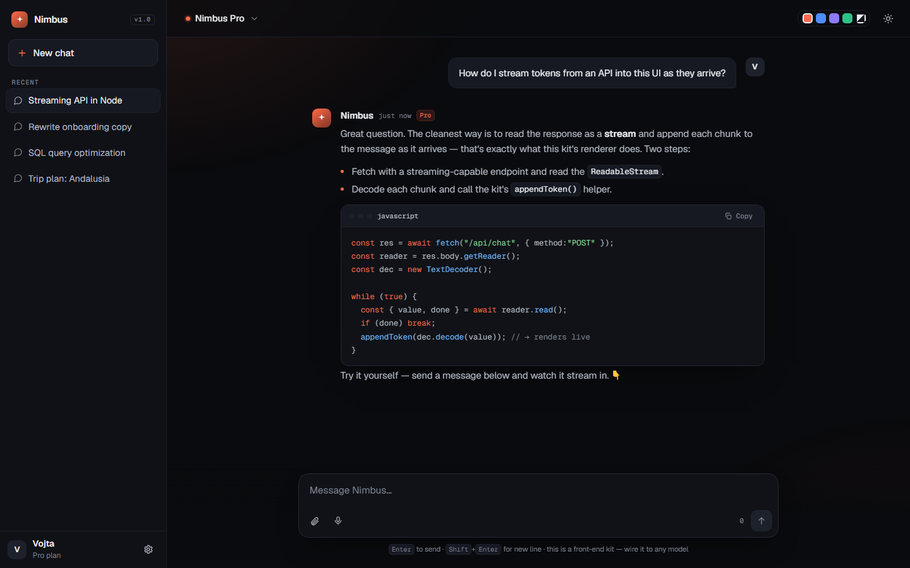

# Nimbus Lite — free AI chat UI kit (HTML, CSS, JS, no framework)

A clean, **framework-free chat interface for AI apps** — vanilla HTML, CSS and JS. Use it as a **ChatGPT-style UI**, or wire it to OpenAI, Anthropic, a local LLM, or any backend that streams tokens.

Open `index.html` and it is already running. Live token streaming, markdown, syntax-styled code blocks with one-click copy, a model picker, and light/dark themes plus five accent colours. No build step, no dependencies, no `npm install`.



Drop it into React, Vue, Svelte, or a plain HTML page and connect your model to the composer. Nimbus Lite is a front-end. Bring your own API.

**Live demo:** https://vojtasve-droid.github.io/nimbus-lite/

## Quick start

```bash
git clone https://github.com/vojtasve-droid/nimbus-lite
cd nimbus-lite
# open index.html in your browser — that's it
```

No install, no bundler. Copy the markup you need into your project and swap the demo streamer for your API call — append tokens to the assistant message as they arrive:

```js
const res = await fetch("/api/chat", { method: "POST", body });
const reader = res.body.getReader();
const dec = new TextDecoder();
while (true) {
  const { value, done } = await reader.read();
  if (done) break;
  appendToken(dec.decode(value)); // → renders live in the UI
}
```

## What's included (free)

- Full chat layout — sidebar, conversation list, header, composer
- Live token **streaming** with a blinking caret
- Markdown message styling and **syntax-styled code blocks** with one-click copy
- Model picker, typing indicator, message actions
- Light / dark themes + 5 accent colours — recolour with **one CSS variable**
- Responsive, keyboard-friendly, accessible focus states

## Free vs. full kit

Nimbus Lite is the free front-end. The **full Nimbus kit** adds the production pieces most kits skip:

| | Lite (this repo) | [Full kit, $19](https://sventek7.gumroad.com/l/qyxave) |
|---|:---:|:---:|
| Streaming, markdown, code blocks | Yes | Yes |
| Light/dark + 5 themes | Yes | Yes |
| Sources and **citations** (inline + cards) | — | Yes |
| Collapsible **reasoning / "thinking"** block | — | Yes |
| **Tool-call chips** for agent apps | — | Yes |
| **File and image attachments** | — | Yes |
| **Error + retry** states | — | Yes |
| Docs, commercial license, updates | — | Yes |

👉 **Free lite on Gumroad** (same kit): https://sventek7.gumroad.com/l/dlpkva

👉 **Full Nimbus kit — $19:** https://sventek7.gumroad.com/l/qyxave

## FAQ

**Does it work with ChatGPT / OpenAI / Anthropic?** Yes, as a UI. Point the composer at your own backend or proxy and stream tokens into `appendToken`.

**Do I need React?** No. It is vanilla HTML, CSS and JS. You can still drop the markup into a React, Vue or Svelte app.

**Is there a build step?** No.

**Can I use it commercially?** Yes, in your own projects. Please don't resell the kit itself. See [LICENSE](LICENSE).

## License

Free to use and modify in your own projects, personal or commercial. Please don't resell the kit itself as-is. See [LICENSE](LICENSE).

---

Built by [Vojtěch Sventek](https://github.com/vojtasve-droid). Found a bug or want a feature? [Open an issue](https://github.com/vojtasve-droid/nimbus-lite/issues).
